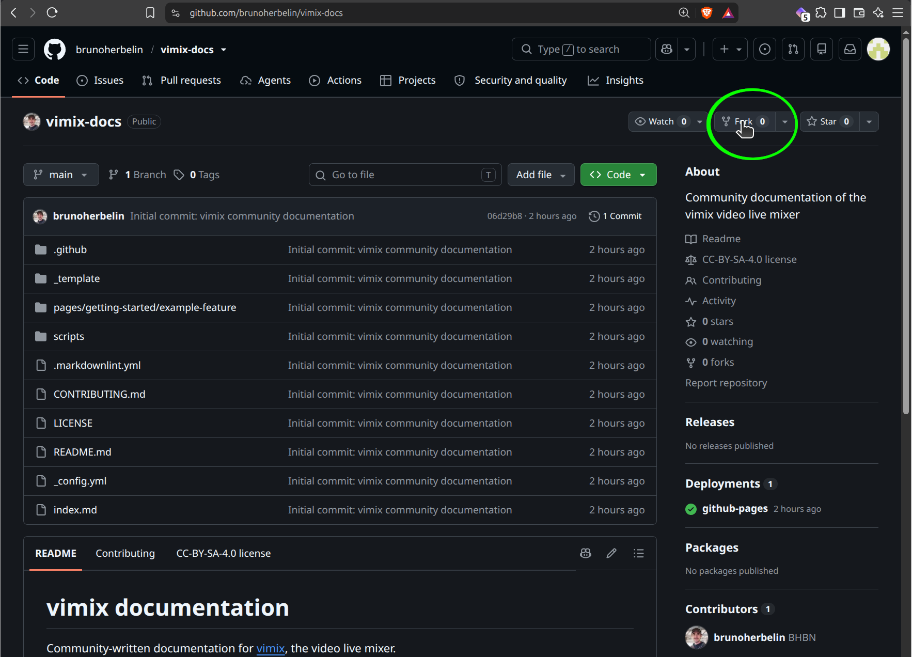
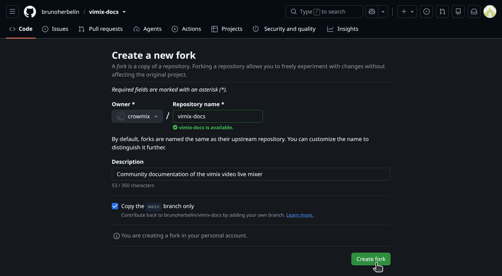
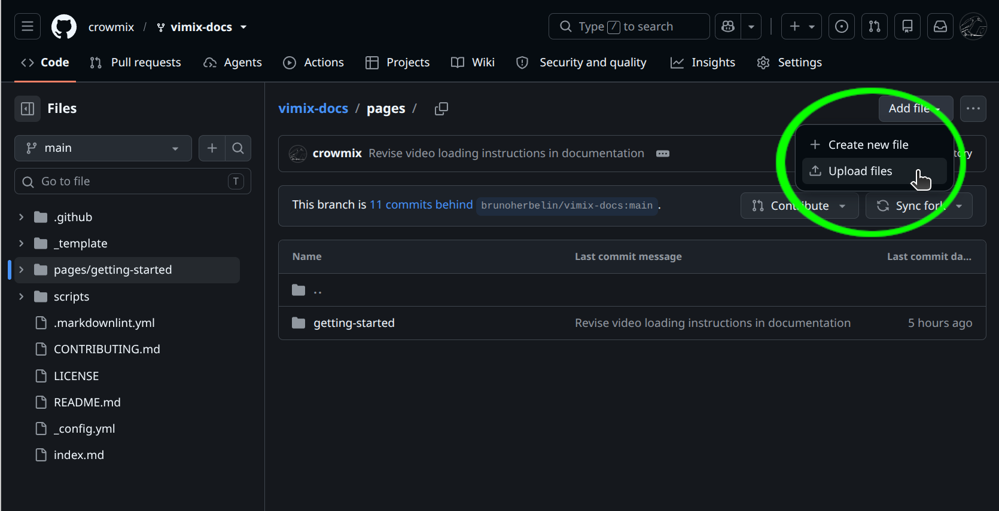
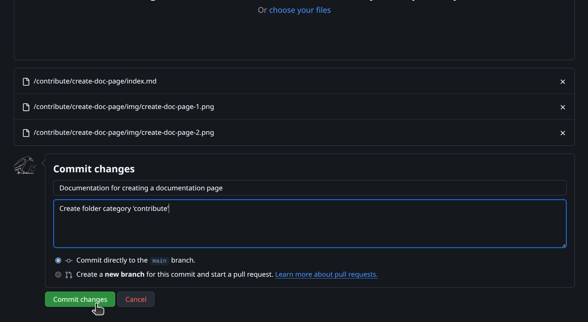
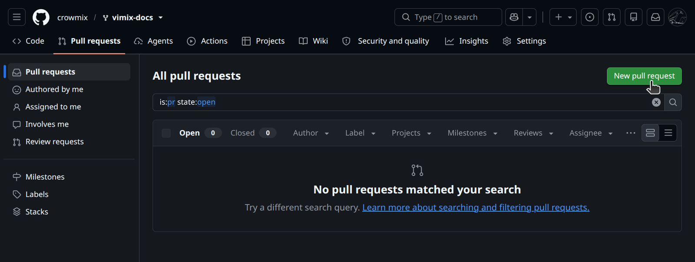
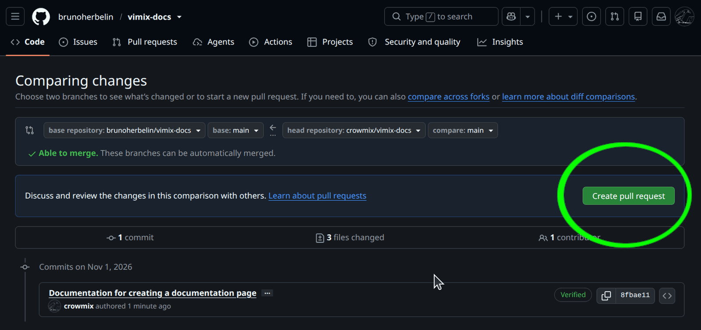
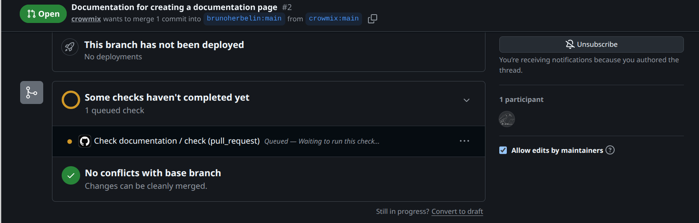
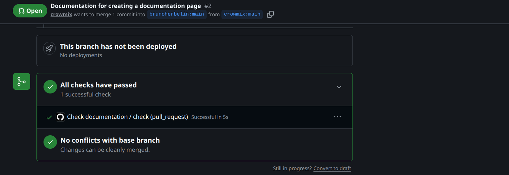

## What it does

To contribute to vimix documentation on [vimix-docs](https://github.com/brunoherbelin/vimix-docs), first prepare your files following the instructions [here](https://brunoherbelin.github.io/vimix-docs/pages/contribute/create-doc-page/). You can then upload them directly on github using a web browser. 

The process requires that you have a [github account](https://github.com/signup) and that you create a pull request. The rest is automatic.

## How to

1. Fork [vimix-docs](https://github.com/brunoherbelin/vimix-docs) repository.

   Open [vimix-docs](https://github.com/brunoherbelin/vimix-docs) in a web browser and make sure you are [logged-in](https://github.com/login). Clic on `Fork` to create a copy in your account:

   

2. Validate the creation of the fork 

   

3. Inside your forked copy of `vimix-docs`, navigate to the `pages` folder and choose to `Upload Files`

   

4. Drag & Drop the folder you prepared with the documentation and `Commit changes`.

   

   __IMPORTANT.__ As explained [here](https://github.com/brunoherbelin/vimix-docs/blob/main/CONTRIBUTING.md), vimix documentation is structured into folders for different categories. Category names are for instance `getting-started`, `sources`, `contribute`, etc. You can use a category already existing or propose a new one (e.g., you could propose a category `open-sound-control`). Follow the instructions [here](https://brunoherbelin.github.io/vimix-docs/pages/contribute/create-doc-page/) to create the documentation page and images and put them into a directory with a meaningful name. This folder should only contain one `index.md` file and an `img/` folder containing the screnshots in `PNG` format.

   Example; for a documentation on __"how to create a camera source"__ for the __"getting started"__ category, you would prepare the following folders and files; 

   ```
   getting-started/
   | --- create-camera-source/
   |      | --- index.md
   |      | --- img/
   |             | --- screenshot-1.png
   |             | --- screenshot-2.png
   ```
  
   => Drag the folder `getting-started/` (= the category) into the github `vimix-docs/pages`. Fill the commit information (Tile and description).

5. Create a pull request

   After your files are committed, go to `Pull requests` in the github menu bar (next to `<> Code`) and click on `New pull request`.

   
  
   The system localizes the changes and new files that you added; you can now confirm and `Create pull request`;

   

6. The pull request is being checked

   

   If validation fails, follow the errors indication to understand what was wrong. Close the pull-request and make changes to your commit to fix the problem. Re-open the pull request. 

7. The pull request is valid

   

   That's all for you !

   After validation, the pull-request will be accepted by __vimix-docs__ maintainers. This can take some time depending on their availability. 


## Specific information

- This documentation page is for users more familiar with web-browser interface than using command lines; the same process can be done with git. See [vimix-docs website](https://github.com/brunoherbelin/vimix-docs/blob/main/README.md) for more info.
- There is no shame in asking help of an AI agent for this github procedure ;)
- Related page : 
    [Create a vimix documentation page](https://brunoherbelin.github.io/vimix-docs/pages/contribute/create-doc-page/)
