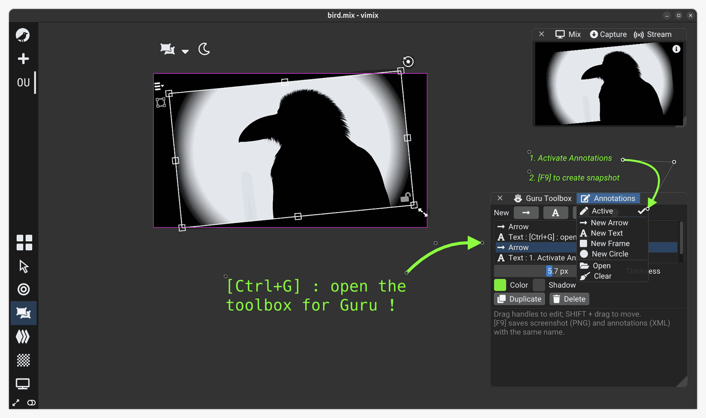
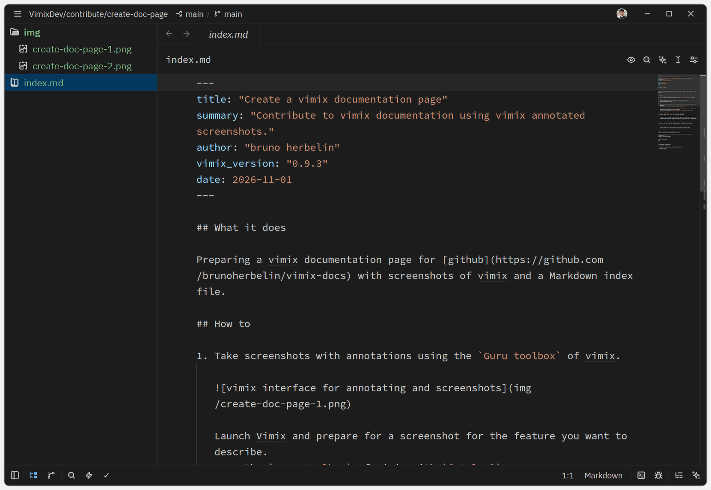

## What it does

Prepare a page for the [Community documentation of vimix](https://brunoherbelin.github.io/vimix-docs) with screenshots and a Markdown index file.

The files are then ready to be proposed to the [vimix-docs](https://github.com/brunoherbelin/vimix-docs) repository following these [instructions](https://brunoherbelin.github.io/vimix-docs/pages/contribute/create-doc-page-github-upload/).

## How to

1. Take screenshots with annotations using the `Guru toolbox` of vimix.

   

   - Launch Vimix and prepare for a screenshot for the feature you want to describe. 

   - Open the `Guru toolbox` of vimix with `[Ctrl+G]`. Activate `Annotations`.

   - Add overlay Arrows, Texts, Rectangles or Circles on top of Vimix user interface to illustrate the user action. Move and adjust them using the dots and the parameters.

   - Take a screenshot from `Guru toolbox` / `Screenshot vimix` or by pressing `[F9]` key. The screenshot `png` file is saved in your home directory.
   
2. Create a text file `index.md` based on the template

   Download the template [index.md](https://github.com/brunoherbelin/vimix-docs/blob/main/_template/index.md).

3. Copy all screenshots in a directory `img\`  next to `index.md` 

4. Open `index.md` in a text editor.

   Here is an example with [Zed editor](https://zed.dev/)
   

5. Fill `index.md` with the description of the feature you want to describe.

   - Follow the template and provide required meta information;

```
---
title: "Feature name"
summary: "One sentence describing what this feature does."
author: "Your name or GitHub handle"
vimix_version: "0.9.3"
date: 2026-11-01
---
```   

  - Give a short description of the feature;

```
## What it does

Two to four sentences explaining the feature and when to use it.

```

  - Give a step by step instruction, referencing the screenshots that you prepared earlier. It is important to provide alternative text describing the screenshot;

```
## How to

1. Describe the first user action.

   

2. Describe the second user action.

   

## Specific information

- Shortcuts, limitations, platform differences.
- Related pages.


```


## Specific information

- Read the [contribution instructions](https://github.com/brunoherbelin/vimix-docs/blob/main/CONTRIBUTING.md).
- When saving a screenshot, vimix also saves a description of the annotation (`.xml`); you can keep and re-use these files. They can be deleted when you don't need them anymore.
- The screenshot filenames are given with their relative path to the `img/` folder ; e.g., as in ``.
