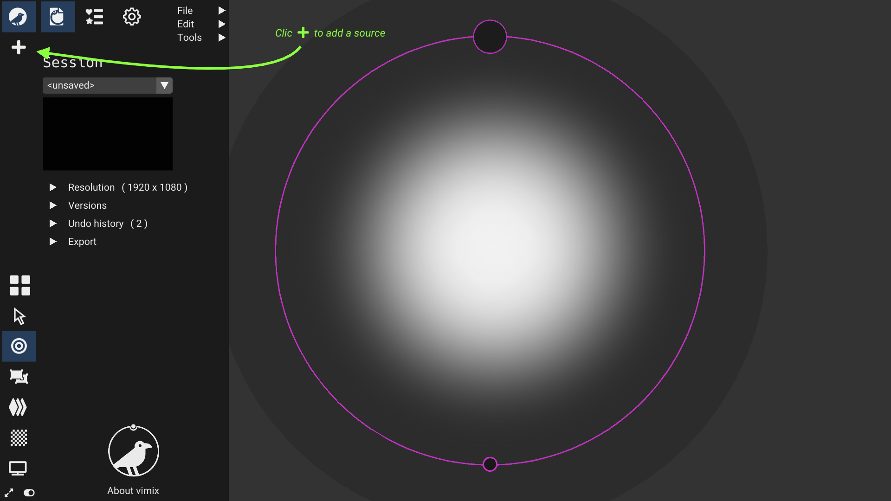
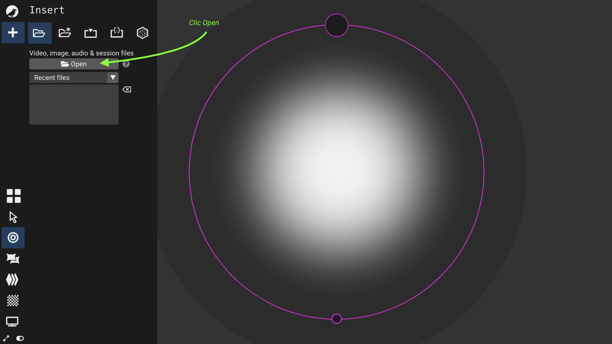
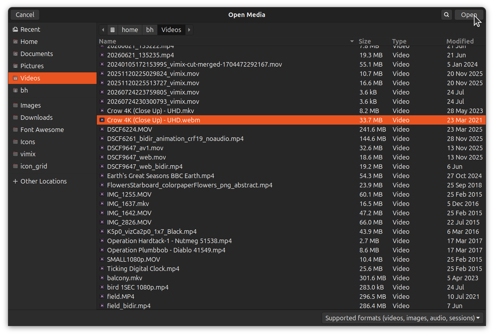
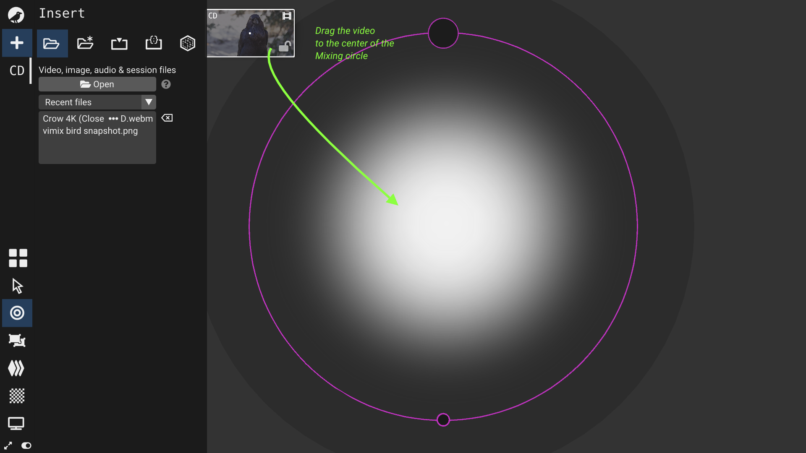
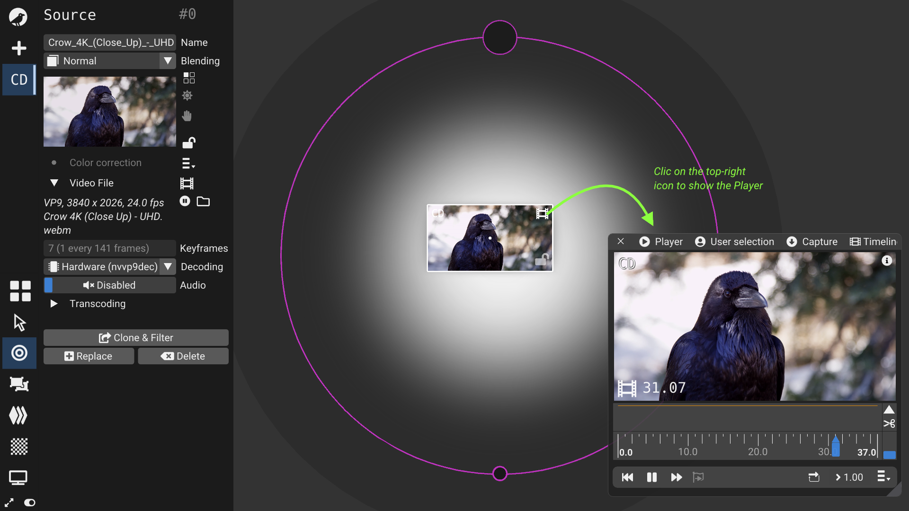
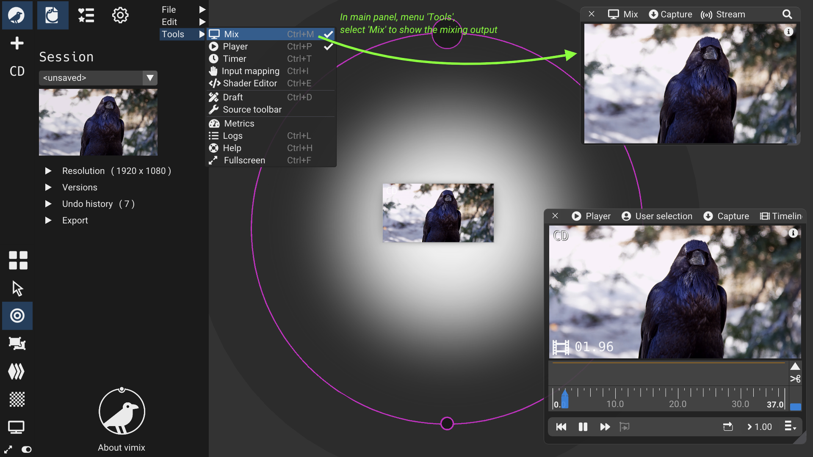

## What it does

Load a video file, place it in mixing view to adjust its opacity, show it in the mix output.

## How to

1. Clic on `+` in left panel to add a source.

   

2. Clic `Open` .

   

3. Select a video file in the file selection dialogue, validate with `Open` .

   

4. Drag the video icon in the mixing circle.

   

5. Clic Media icon on the source top-right corner to open the media Player.

   In the Media player, you can press Play/Pause, seek forward, 
   
   
   
7. Your video is in the mix output; open the Mix window with menu `Tools`/`Mix`.

   

## Specific information

- [Ctrl+P] to opens the media Player.
- [Ctrl+M] to open the Mix output
- You can also drop the video file from your desktop environment.
